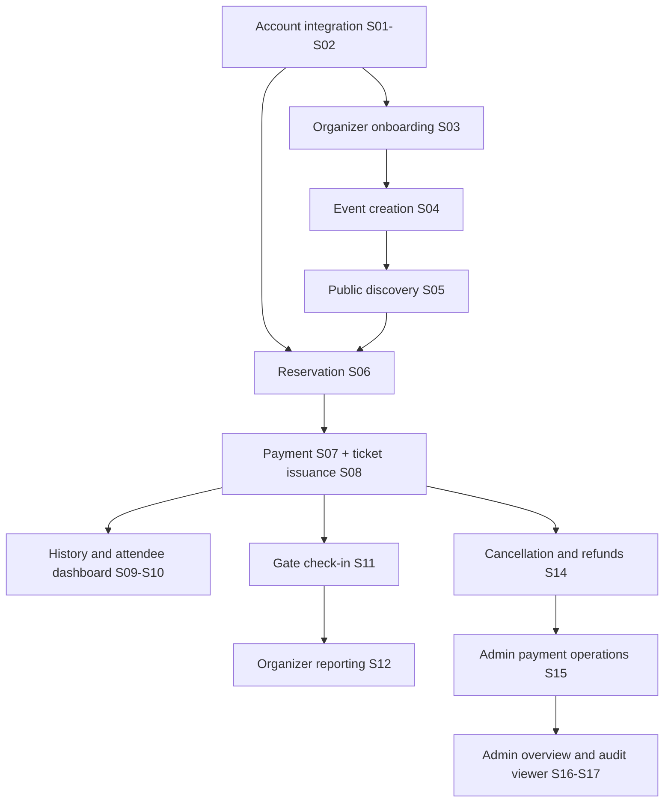

# Aventix backend implementation and frontend integration plan

Prepared from the repository on 2026-10-21. This is a source-based feature inventory and proposed implementation guide. Screens, types, mocks, and database models demonstrate intent; they do not prove that a workflow works against a running backend. No database or external service was contacted for this analysis.

## How to use this plan

Implement one vertical slice at a time: persisted data and business rules, an authorized API, frontend integration, and a demonstrable user outcome. Do not implement all tables, then all endpoints, then all screens. Each slice below includes its dependencies, backend work, integration targets, and acceptance checks.

The existing [Phase 1 requirements](backend/documents/phases/phase-1-authentication.md), [authentication integration contract](backend/docs/specs/phase-1-integration-contract.md), and [fixed account roles decision](backend/docs/adr/0001-fixed-account-roles.md) remain authoritative. This plan extends beyond Phase 1 and does not replace those documents or turn frontend mock behavior into approved business rules. Proposed endpoints and unresolved decisions should be finalized when implementing the relevant slice.

## 1. Existing frontend features

Status meanings: **API adapter** means request code exists but compatibility still needs checking; **mock** means fixtures, in-memory mutations, or browser storage supply the behavior; **placeholder** means the screen exists but its action is not implemented.

| Area and routes | Existing features | Current implementation and evidence |
| --- | --- | --- |
| Home `/` | Hero search, trending cards, browse by category, registration calls to action, informational sections | Trending uses the shared event loader; “trending” currently means its first four events. Other marketing content is static. [Home](src/app/page.tsx), [TrendingEvents](src/components/TrendingEvents.tsx) |
| Event discovery `/events` | Search by event/performer; location, date, category, genre filters; month grouping; empty/loading/error states | API adapter with mock fallback when no API URL is set. Filtering happens in the browser after loading the full list. [EventsBrowser](src/components/events/EventsBrowser.tsx), [event loader](src/lib/events-api.ts) |
| Event details `/events/[id]` | Poster/banner/gallery, performers, venue/map information, organizer, ticket prices and sale availability, related events, optional playlist metadata | Shared API adapter or mock events. Playlist is a metadata preview without playback. [Detail page](src/app/events/[id]/page.tsx), [event types](src/types/event.ts) |
| Accounts `/register`, `/register/attendee`, `/login` | Account choice, attendee form, terms checkbox, login, session-based navigation, logout, safe booking return destination | API adapter exists but targets obsolete native auth routes. Registration consent/version and verification are not integrated. [AuthForm](src/components/auth/AuthForm.tsx), [auth adapter](src/lib/auth/better-auth.ts) |
| Recovery `/forgot-password`, `/reset-password` | Recovery request and reset forms; UI for invalid/expired links | Adapter methods are absent, so the forms cannot complete recovery. No dedicated frontend email-verification or legacy-consent completion page exists. [Auth client](src/lib/auth/client.ts) |
| Organizer application `/register/organizer` | Two-step preview of contact, organization, description, username, and credential fields | Explicitly disabled preview; collects/submits no application. Policy is undecided. [OrganizerPreview](src/components/auth/OrganizerPreview.tsx) |
| Public purchase `/events/[id]/tickets`, `/events/[id]/seats` | Ticket quantities, allowance checks, numbered-seat choices, session checks, draft preservation, handling of changed inventory | Functional frontend components with an empty booking adapter. Drafts in session storage do not reserve inventory. [Booking client](src/lib/booking/client.ts), [booking components](src/components/booking) |
| Booking `/bookings/[bookingId]/summary`, `/payment`, `/confirmation` | Reservation timer, authoritative totals display, cancellation, payment method/instruction UI, status refresh, refund status, issued-ticket links | Uses the same empty adapter. Handles uncertain requests and rejects inconsistent records. No real booking/payment is created. [BookingRecordView](src/components/booking/BookingRecordView.tsx) |
| Legacy purchase `/dashboard/buy-tickets` | Alternate ticket/seat flow and printable e-ticket presentation | Mock flow simulates confirmation and writes tickets into local storage. Its QR-like SVG is decorative rather than an encoded QR. [InteractiveTicketFlow](src/components/booking/InteractiveTicketFlow.tsx), [QRCodeSVG](src/components/booking/QRCodeSVG.tsx) |
| Attendee `/dashboard` | Ticket/upcoming-event/spending/reward cards and upcoming-event table | Sample fallback even on request failure; proposed endpoint integration is incomplete. [Dashboard data](src/lib/dashboard.ts) |
| Attendee `/dashboard/tickets` | Ticket stats, upcoming/past/cancelled tabs, status badges, QR-pass presentation, cancellation/refund notes | API adapter plus sample data and legacy local-storage tickets. Pending local bookings can be displayed as valid tickets. [Ticket data](src/lib/tickets.ts), [TicketsView](src/components/tickets/TicketsView.tsx) |
| Attendee `/dashboard/booking-history` | Booking references, quantity, totals, statuses, date filter, PDF buttons | Inline sample records; date filtering works locally; PDF action is a placeholder. [History page](src/app/dashboard/booking-history/page.tsx) |
| Attendee `/dashboard/profile` | Personal information form and membership summary | Hardcoded identity/tier; save action is a placeholder. Email appears editable despite Phase 1 restrictions. [Profile page](src/app/dashboard/profile/page.tsx) |
| Organizer `/organizer/dashboard`, `/organizer/events` | Summary metrics, active events, recent sales, event cards, create/edit/public links, search/status controls | Dashboard sample fallback. Event list reuses dashboard data. Search/filter controls are unwired; `/organizer/events/[id]` edit destination has no page. [Organizer data](src/lib/organizer.ts), [events page](src/app/organizer/events/page.tsx) |
| Organizer `/organizer/events/new` | Event title/category/date/venue/description inputs; draft and next-step buttons | Placeholder form: no save, ticket-tier editor, seating configuration, upload, or publishing workflow. [Create page](src/app/organizer/events/new/page.tsx) |
| Organizer `/organizer/check-in` | Camera viewport, manual code field, validate button, recent-scan stream | Static scanner illustration and sample stream; no camera decoding or validation request. [Check-in page](src/app/organizer/check-in/page.tsx) |
| Organizer `/organizer/analytics` | Date range, revenue/order/attendee cards, tier performance, CSV button | Date picker state exists; metrics and tier figures are static; export is unwired. [Analytics page](src/app/organizer/analytics/page.tsx) |
| Organizer `/organizer/profile` | Approval badge, bank details, organization name/contact/bio, save button | Hardcoded approved status and bank data; no profile/payout persistence. [Organizer profile](src/app/organizer/profile/page.tsx) |
| Admin `/admin/dashboard` | Summary cards, sales chart, booking-status chart, recent users/events/bookings | Mock service. Existing backend overview does not match these frontend contracts. [Dashboard service](src/app/admin/services/dashboardService.ts) |
| Admin `/admin/users` | Search/status filter, pagination, stats, detail modal, activation/deactivation, CSV | In-memory service with proposed HTTP calls behind `USE_MOCK = true`. [User service](src/app/admin/services/userService.ts) |
| Admin `/admin/organizers` | Search/status filter, pagination, stats, details/recent events, approve/reject with reason, CSV | Mock service; application and approval lifecycle is not implemented. [Organizer service](src/app/admin/services/organizerService.ts) |
| Admin `/admin/events` | Search/category/status filter, pagination, stats, event/tier details, availability changes/cancellation reasons, CSV | Mock service; real cancellation and refund side effects are absent. [Event service](src/app/admin/services/eventService.ts) |
| Admin `/admin/bookings`, `/admin/payments` | Search/status/event filters where applicable, pagination, filtered stats, details, payment timelines, CSV; booking payment decisions with notes | Mock services. Manual paid/refunded actions do not perform actual settlement. [Booking service](src/app/admin/services/bookingService.ts), [payment service](src/app/admin/services/paymentService.ts) |
| Admin `/admin/activity-logs` | Search/category/result/date filters, pagination, filtered stats, actor/change/error details, CSV | Mock viewer; backend already has an activity-log model and auth audit writes. [Activity service](src/app/admin/services/activityLogService.ts) |
| Admin `/admin/profile` | Profile/security forms, password change, avatar preview/upload validation, account activity | Mock service; avatar uses a data URL in local storage. Profile email/full-name contracts conflict with Phase 1. [Profile service](src/app/admin/services/profileService.ts) |
| Admin `/admin/settings` and notification bell | General/notification/security/appearance/system preferences; password modal; maintenance switch; unread/read interactions | Mock settings persistence. Bell has local state and defaults to no notifications. Security toggles do not implement security features. [Settings types](src/app/admin/types/settings.ts), [NotificationBell](src/app/admin/components/ui/NotificationBell.tsx) |
| `/contact`, `/about`, `/about/experience`, `/legal/[policy]` | Contact validation, informational pages, legal routes | Contact opens an email app with `mailto:`; legal content is explicitly unpublished. Static informational content needs no backend by default. [ContactForm](src/components/contact/ContactForm.tsx), [legal page](src/app/legal/[policy]/page.tsx) |
| `/connection-test`, `/preview/booking` | Development connection diagnostics and isolated booking UI review | Development aids, not completed customer workflows. Keep preview data separate from real purchases. |

## 2. Backend starting point and integration gaps

The backend is **Express 5 + TypeScript + Prisma/PostgreSQL + Better Auth**, not the obsolete NestJS/Next.js backend descriptions. Consult [backend instructions](backend/AGENTS.md) and the actual [backend manifest](backend/package.json).

- Authentication/account lifecycle code and tests already exist: registration/consent, verification, sessions, recovery/reset, password change, self-profile, and trusted account commands. Reuse and verify these implementations rather than rebuilding authentication. Their existence does not establish deployment readiness or a passing test suite in the current environment.
- [Prisma schema](backend/prisma/schema.prisma) already models users, organizer profiles, venues, events, media, categories, seats, bookings/items/allocations, payment attempts, tickets, verification attempts, and activity logs. Extend these models incrementally; do not start a parallel schema.
- The guest, attendee, organizer, and admin [services](backend/src/services) currently return hardcoded responses, empty arrays, or simulated success. In particular, the organizer check-in service accepts arbitrary codes; it must be replaced before use.
- [Business route middleware](backend/src/middlewares/role.middleware.ts) expects `req.user`, but [app assembly](backend/src/app.ts) does not populate it for those routers. Controllers also omit the authenticated identity when calling attendee/organizer services. Having routes and role checks does not make these features integrated.
- [SQL constraints](backend/prisma/sql/initial_constraints.sql) include one active allocation per seat and positive/nonnegative values. Verify migration and database state before relying on them. A schema file alone does not prove constraints are installed.

### Resolve these conflicts deliberately

| Current mismatch | Required planning/integration action |
| --- | --- |
| Frontend calls `/api/auth/ok`, `sign-in/email`, `sign-up/email`, `get-session`, `sign-out`; backend exposes a strict Aventix allowlist | Map to existing `/api/auth/login`, `/register`, `/logout`, and `/api/v1/me`. Replace the connection check using the existing health API where useful. Do not reopen blocked native routes. |
| Frontend auth expects raw Better Auth user/session results and top-level error codes | Adapt `{ data: ... }` and `{ error: { code, message, ... } }`; derive UI session/navigation from the permitted `/me` profile, without requesting session tokens. |
| Frontend offers remember-me, 8–128-character passwords, mandatory/formatted phone, and no terms version | Preserve fixed seven-day sessions with no remember-me option; use 15–128 Unicode code points, exact passwords, optional phone under the backend's accepted format, and genuine current terms/version. Update frontend validation and copy. |
| Backend issues verification/reset links to backend landing paths; reset UI expects an adapter to verify a link before enabling submission | Define how existing purpose-bound fragment tokens reach completion forms. The backend has no separate reset-token preflight API. Do not pretend a locally parsed link has been server-validated or consume it during preflight. |
| Only auth requests have a Next.js rewrite; API variables differ (`API_URL`, `NEXT_PUBLIC_API_URL`, `NEXT_PUBLIC_API_BASE_URL`) | Adopt one documented transport convention for application `/api/v1` routes. Support both browser requests and authenticated server-rendered reads; forward cookies explicitly for server-to-server reads. Do not assume the auth-only rewrite covers `/me` or business endpoints. |
| Frontend public loader requests `/events` and `/events/:id`; backend has `/api/v1/guest/events` returning incompatible cards and no detail route | Proposed canonical public resource: `/api/v1/events` and `/api/v1/events/:id`; replace or temporarily adapt the guest stub and update base URLs. Return the validated event view shape. |
| Frontend layouts and `useRole()` infer role context from pathname | Add server/session-aware page access checks for all three workspaces. Keep Express authorization authoritative; URL selection or demo switching never grants access. |
| Business routers explicitly include administrators in attendee/organizer role allowlists | Review each operation's permitted roles. Approved roles have no automatic hierarchy; separate admin views should not silently act as an attendee/organizer. |
| Organizer creator lists conference/sports/theater; mocks also show non-music events | Current domain and schema cover concert, gig, music festival. Limit UI/options to these unless scope is explicitly expanded. |
| Public event type excludes stored `DRAFT` and `SOLD_OUT`; event model lacks genre, performer array, city, playlist, seat-plan URL | Hide drafts publicly; agree whether sold-out is a public event status or derived category availability. Add missing content fields only where needed and map timestamps/performers deliberately. |
| Frontend booking validators require a numbered seat per ticket; schema also supports general admission | Implement assigned seating first, or extend view models/validators for explicit admission mode before selling general admission. Do not create fictitious seat IDs to satisfy validation. |
| Admin/user/organizer/booking/refund statuses use different names from database enums | Define explicit DTO mappings and extend UI unions for missing states. `pending` is not a new account status; booking `completed` is not a stored booking status. Refund `COMPLETED` in tickets maps to a successful refund, not event completion. |
| Admin profile permits email changes; settings show 2FA, idle timeout, and alternate role labels | Reuse current allowed profile/password operations. Email/avatar/security extensions and a `superadmin` distinction are separate scope decisions; UI mock fields do not authorize changing account rules. |

## 3. Shared conventions for every slice

These are proposed conventions for new business APIs; existing approved auth contracts take precedence.

1. **Transport:** application endpoints below are relative to `/api/v1`; auth endpoints keep their full `/api/auth/...` names. Use credentialed cookie requests, explicit allowed origins, and mutation-origin/CSRF checks consistent with the existing auth boundary. Preserve Better Auth handler ordering before Express JSON parsing.
2. **Results:** use `{ data: ... }` for object results and `{ data: [...], total, page, pageSize }` for paginated lists; use safe `{ error: { code, message, fields? } }` failures. Adapt existing admin clients that currently expect raw objects. CSV/PDF/image downloads return appropriate file content instead of JSON.
3. **Identity:** resolve the current session and current account eligibility through the existing lifecycle checks, then enforce explicit roles and resource ownership. Never accept an attendee/organizer identity supplied by the browser as authorization.
4. **Values:** store money using database decimal or integer minor units and calculate totals on the server; convert deliberately to the existing numeric PHP view models. Store instants in UTC; interpret date-only filters and display event calendars in `Asia/Manila` unless a later feature explicitly permits another timezone.
5. **Mutations:** validate inputs, enforce invariants in a transaction, and write audit records for privileged/state-changing operations as part of their slice. Add idempotency to booking/payment/refund operations before exposing retries. Keep raw credentials and verification tokens out of logs.
6. **Lists:** validate/bound paging and query parameters, use stable ordering, and reuse each list's filter logic for exports and filtered stats. User/organizer/event stats currently represent global totals; booking/payment/log stats represent the current filtered result. Export all matching records, not just the visible page, and safely encode CSV cells.
7. **Frontend:** integrate through the existing `src/lib` clients and admin service modules. Remove sample fallback and local success simulation from connected production paths. Show loading, empty, validation, authentication, permission, conflict, and unavailable states truthfully.
8. **Scope:** choose straightforward implementations for this school project. Database transactions, polling, and a scheduled expiry/refund reconciliation command are sufficient starting points; no microservice or realtime infrastructure is required.

## 4. Vertical slices

### S01 — Register, verify, sign in, and sign out as an attendee

**Outcome:** A real attendee creates an account, verifies ownership with their password, signs in, and sees the correct account navigation. **Dependencies:** existing Phase 1 implementation; reviewed terms and configured delivery for real users.

**Backend/API:** Reuse `User`, `Account`, `Session`, `AuthLink`, cooldown/rate-limit records; existing `GET /terms`, `GET /me`, `POST /api/auth/register`, `/verify-email`, `/resend-verification`, `/login`, `/logout`, and `/accept-terms`.

**Interview decisions:** All nineteen recommendations and the consolidated [S01 integration decisions](backend/docs/specs/s01-attendee-authentication.md) were confirmed on 2026-10-21; the planning interview is complete. They cover fixed frontend verification/reset pages and existing-link bridges, recovery request/reset moved into S01, same-origin browser transport with explicit server-side cookie forwarding, `/events` as the default attendee destination, truthful session/failure states, and unavailable content for unfinished workspaces. Planning confirmation does not start implementation.

1. Check the current implementation against the approved contract and existing auth tests. Confirm configuration/migrations and delivery without fabricating verification or consent.
2. Replace native auth calls and response/error parsing in the frontend adapter. Obtain current terms before registration; omit an empty optional phone; never send role, status, derived name, or remember-me fields.
3. Add the missing verification/resend and legacy-consent UI. Correct signup success copy: account creation requires verification and separate login. Handle account-created/email-failed without prompting duplicate registration.
4. Read `/me` for account navigation and booking eligibility. Add account/role checks at protected page/data boundaries as well as workspace layouts, and retain safe internal booking return URLs. Layout-only checks do not protect nested rendering or every navigation in the installed Next.js version.
5. Integrate `POST /api/auth/request-password-reset` and `/reset-password` with the forgot/reset pages so mandatory legacy credential recovery does not dead-end in S01. Token validity remains server-checked at submission; there is no reset-token preflight operation.
6. Keep completion tokens only in memory and immediately strip fragments from browser history, including existing-link bridges. Explain how to reopen a link after reload. Remove role-demo controls from the connected app; refresh account state on navigation/focus and cross-tab hints, and reconcile uncertain logout without claiming success.

**Integrate:** [auth client](src/lib/auth), [auth components](src/components/auth), registration/login/verification/consent/forgot/reset pages, compatibility actions on existing API email landing pages, Navbar/account menu, and protection at workspace page/data boundaries.

**Done when:** Registration persists genuine consent without a session; wrong-password verification leaves a link usable; verified eligible users can log in; reload retains a valid session; logout clears access; recovery consumes reset links and invalidates every session without verifying email or enabling disabled accounts; all workspaces enforce current account eligibility and explicit roles. Cover the authentication/profile API boundary and role middleware without claiming later business APIs are integrated; unfinished business operations remain unavailable. Invalid links, uncertain submissions, outdated terms, and account-service outages follow the confirmed [S01 decisions](backend/docs/specs/s01-attendee-authentication.md).

**Evidence:** Updated frontend tests, passing backend authentication tests on the dedicated database, frontend type/build checks, and an actual localhost browser walkthrough of cookies and protected-page access. Report technical completion separately from real-user activation, which still requires genuine terms and verified real delivery; controlled test mail is not delivery proof.

### S02 — Edit the current account and change its password

Design decisions: [S02 current-account profile and password](backend/docs/specs/s02-current-account-profile-and-password.md).

**Outcome:** A user updates allowed personal fields and changes a known password. Recovery request/reset integration now belongs to S01; this slice reuses that flow. **Dependencies:** S01.

**Backend/API:** Reuse `GET/PATCH /me` and `POST /api/auth/change-password`, plus S01's recovery flow; existing lifecycle/session invalidation code and audits.

1. Reuse the recovery request/reset flow integrated in S01; do not introduce a separate token-preflight operation.
2. Connect attendee and admin personal forms to the same current-user profile; use first/last name and optional phone, keep email read-only, and keep role/status/consent noneditable.
3. Route both admin password entry points through the existing change-password operation instead of inventing independent password implementations.
4. Handle legacy reset-required, link-invalid/expired, password reuse, field validation, and missing consent consistently.

**Integrate:** attendee profile, admin profile/security and settings password modal; link to S01's forgot/reset pages as needed. Admin-specific activity/avatar fields remain separate extensions.

**Done when:** Authenticated password change preserves only the requesting session with its original expiry; invalid profile updates change nothing; clearing a phone persists; users who forgot their current password can reach S01's recovery flow.

### S03 — Apply as an organizer and receive an administrator decision

**Outcome:** A new, separate organizer identity enters review and an administrator approves or rejects the organization. **Dependencies:** S01–S02; organizer onboarding policy decision.

**Data/API:** Extend `OrganizerProfile` for rejection reason/application fields and durable decision history as needed. Proposed `POST /organizer-applications`; `GET /organizer/profile`; admin `GET /admin/organizers`, `/stats`, `/:id`, `/export`; `PATCH /admin/organizers/:id/status`.

1. Specify whether the separate organizer account is created at application or approval, its verification/consent requirements, and rejected/resubmission behavior. Do not convert an existing attendee or reuse their normalized email. Decide whether username/type fields are needed before enabling them.
2. Persist the application and identity atomically where applicable. Use an explicit restricted pending-organizer policy, so review access never implies publishing privileges.
3. Implement paginated/searchable admin review, counts, recent owned events, and CSV. Record approver, timestamp, rejection reason, and audit; guard competing decisions.
4. Replace the disabled application preview and admin mock service only after that contract exists; show actual pending/approved/rejected/suspended states in the organizer workspace.

**Done when:** A real application appears in admin review; approval unlocks the approved organizer actions; rejection reason persists; an unapproved/other organizer cannot publish; an existing attendee's identity remains unchanged.

### S04 — Create, configure, and publish an organizer event

**Outcome:** An approved organizer publishes a purchasable music event with ticket categories and inventory. **Dependencies:** S03; an isolated organizer fixture can support early development.

**Data/API:** Reuse `Event`, `Venue`, `EventMedia`, `TicketCategory`, `EventSeat`. Add missing required content fields, including a clear start/end instant mapping, genre/lineup and city if used, and a seat-plan reference. Proposed organizer `GET/POST /organizer/events`, `GET/PATCH /organizer/events/:id`, category/seat/media operations under that event, and `POST /organizer/events/:id/publish`.

1. Save/reload a draft with server-assigned owner, valid venue/time/sales windows, and unique slug. Enforce owned-resource access and current organizer approval.
2. Add category editing for price, admission mode, capacity, sale windows, and enabled state. Add numbered-seat configuration/import for assigned seating; validate unique labels and category/event membership.
3. Add a bounded poster/banner/gallery upload or validated managed-media workflow. Store URLs/metadata and order; persist optional playlist metadata only if retained in scope, without promising playback.
4. Publish only when details, categories, inventory, and sales rules are consistent. Define restrictions on editing categories/seats/times after holds or sales; do not remove allocated inventory.
5. Implement the currently missing organizer event edit route, draft/next-step actions, search/status list controls, and tier/seat/media editor screens.

**Done when:** An organizer can create, reload, edit, and publish an event; another organizer cannot modify it; incomplete publication fails clearly; published inventory matches configured capacity and seats.

### S05 — Discover and inspect real published events

**Outcome:** Guests browse the same events organizers publish and can inspect accurate ticket availability. **Dependencies:** S04, or representative persisted fixtures during development.

**Data/API:** Proposed public `GET /events`, `GET /events/:id`; reuse event/venue/media/category models. Return a projection compatible with [EventDetails](src/types/event.ts) and [payload validation](src/lib/event-payload.ts).

1. Replace hardcoded guest cards with database queries and complete detail DTOs. Exclude drafts and private organizer data; return 404 for missing/nonpublic events according to the agreed visibility policy.
2. Derive sale availability from event/category state, sale windows, capacities, sold allocations, and unexpired holds. Resolve `SOLD_OUT` mapping rather than passing an unsupported enum into the UI.
3. Connect home trending, event browser, detail, and related cards through the shared loader. Keep existing local filtering initially; if adding server paging, move filters/suggestions/facets together so they cover the full catalog.
4. Return valid image URLs, numeric prices, ISO dates, venue coordinates, and optional metadata. Preserve existing error/not-found/loading screens; use a defined ordering for featured/trending placement.

**Done when:** A newly published event appears publicly; drafts do not; all current search/location/date/category/genre filters work with real content; missing events show not-found and API failures show errors rather than sample events.

### S06 — Reserve ticket quantities and numbered seats

**Outcome:** An authenticated attendee creates a time-limited unpaid booking with exclusive inventory and authoritative totals. **Dependencies:** S01, S04–S05.

**Data/API:** Reuse `Booking`, `BookingItem`, `BookingSeat`, `EventSeat`; add durable operation-key records/constraints and fee snapshots if fees apply. Proposed `GET /events/:id/ticket-options`, `/events/:id/seats`, `POST /bookings`, `GET /bookings/:id`, `POST /bookings/:id/cancel`.

1. Implement `getTicketOptions` with event-wide purchase limit, the current attendee's confirmed quantity and active held quantity; return availability and seat states without exposing other customers.
2. Validate event/category sales state, positive quantities, event/category/seat membership, exact assigned-seat counts, capacity, and combined confirmed-plus-held allowance. Recompute prices/fees; do not trust browser totals or user IDs.
3. Create booking/items/holds atomically. Use database concurrency protection for both seat allocation and per-attendee limits; lock/capacity protection must also cover general admission if enabled. Preserve the existing active-seat uniqueness constraint.
4. Persist idempotency scoped to user and operation, reject the same key with different input, and define how a timed-out request is recovered by replaying its key or finding its booking. A browser `operationKey` alone supplies no guarantee.
5. Set one server-owned expiry. Release unpaid inventory on expiry/cancellation using repeatable transaction logic, a simple scheduled sweep, and expiry-aware reads. Cancellation and payment races must resolve to one valid outcome.
6. Fill `publicBookingClient` and connect ticket selection, seats, and summary. Keep session-storage drafts advisory. Retire the local-storage purchase path or make it delegate to this same booking workflow.

**Done when:** Concurrent buyers cannot hold the same seat or oversubscribe capacity; parallel bookings cannot bypass purchase limits; repeated keys create one booking; refresh preserves totals/expiry; expiry/cancellation releases inventory; another attendee cannot read or cancel it.

### S07 — Start payment and confirm settlement

**Outcome:** A reserved booking can be paid through an agreed payment service and becomes confirmed only after trusted settlement. **Dependencies:** S06; provider/sandbox and supported methods decision.

**Data/API:** Reuse `Payment`; add durable callback/event deduplication and payment-operation identity as needed. Proposed `GET /bookings/:id/payment-methods`, `POST /bookings/:id/payments`, provider callback endpoint, and existing `GET /bookings/:id` for authoritative refresh.

1. Choose the actual payment provider and credentials/sandbox; expose only supported methods. Mock labels such as GCash/Card/Maya are not proof of support. Define expiry and late-settlement policy before activation.
2. Persist an idempotent attempt for the booking's server-calculated amount/currency and original expiry. Handle uncertain provider creation results through lookup/reconciliation before retrying another charge.
3. Return informational instructions/QR or an approved HTTPS redirect, matching the frontend's payment-origin allowlist. Browser redirects/query parameters never mark a booking paid.
4. Verify callbacks using the chosen provider's contract; match reference, booking, amount, currency, and event identity; deduplicate and reconcile out-of-order results. A failed later attempt cannot undo a paid booking.
5. Atomically confirm eligible payment/booking/allocations and trigger idempotent ticket issuance. Keep late/duplicate charges visible for reconciliation/refund rather than resurrecting expired inventory. Add a retryable reconciliation command for missed callbacks.
6. Implement payment-method/instruction client methods and status refresh. Payment retry must not extend the hold. For zero-price categories, explicitly decide a free-booking confirmation path or prohibit them; the current positive-payment constraint cannot represent a zero-value payment.

**Done when:** Sandbox settlement produces one confirmed booking; forged return URLs do nothing; duplicate/out-of-order callbacks do not double-confirm; amount mismatches fail; payment/expiry/cancellation races follow the agreed policy.

### S08 — Issue and display authentic attendee tickets

**Outcome:** A paid attendee receives one admission credential per purchased ticket and can display a scannable pass. **Dependencies:** S07; implement issuance within its settlement transaction or through a durable retry mechanism before calling the paid flow complete.

**Data/API:** Reuse `Ticket` and allocation relations. Replace stub `GET /attendee/tickets`; propose owner-only `GET /attendee/tickets/:id` and pass retrieval/download under that ticket. Feed `issuedTickets` and `myTicketsHref` into booking confirmation.

1. Issue the exact quantity once, link assigned seats where applicable, generate unpredictable verification credentials, and persist verification hashes. Define safe owner-only credential retrieval/re-rendering; storing only a hash does not allow reconstructing a raw token later.
2. Define server ticket expiry/admission rules using event start/end and ticket state. The current frontend assumption that a ticket expires at event start must not decide gate eligibility.
3. Return ticket event/category/seat/status and separate refund state. Replace the decorative QR generator with real QR encoding shared with the scanner contract.
4. Connect My Tickets tabs/stats and printable pass to server records. Remove merging `aventix_attendee_tickets` into real admissions; an unpaid reservation is never a valid ticket. Protect pass endpoints and avoid caching credentials publicly.

**Done when:** Paid multi-ticket bookings issue exactly that quantity; reload on another device shows the same tickets; unpaid bookings show no valid passes; an actual decoder reads the pass; another attendee cannot retrieve it.

### S09 — View booking history and download receipts

**Outcome:** An attendee can find past and pending purchases, reopen their booking, and download a receipt for a settled purchase. **Dependencies:** S06–S08.

**Data/API:** Replace `GET /attendee/bookings` stub; proposed `GET /attendee/bookings/:id/receipt`. Reuse booking/item/payment snapshots; add receipt number/content snapshot only if necessary.

1. Query only the signed-in attendee's bookings with stable paging and inclusive Manila booking-date filters. Return immutable reference, canonical status, quantities, totals, payment/refund summary, and a booking detail link.
2. Replace inline history rows and `COMPLETED` mock labels with deliberate status mapping. Allow reopening pending/uncertain bookings instead of creating replacements blindly.
3. Generate an owner-authorized receipt/PDF from paid server records. Keep cancelled/refunded history, and agree what refunded receipts show. A tax invoice requires actual issuer/tax details and numbering policy; do not label a generic receipt a tax invoice by default.

**Integrate:** booking-history date/table/PDF controls and the booking-summary route.

**Done when:** History totals match settlement records, date filters/paging persist, authorized downloads contain the right purchase, and another attendee's receipt is inaccessible.

### S10 — Populate the attendee dashboard

**Outcome:** The dashboard summarizes the signed-in attendee's actual tickets, upcoming events, and spending. **Dependencies:** S08–S09.

**Data/API:** Replace `GET /attendee/dashboard` stub with aggregates over owned bookings/payments/tickets/events.

1. Define active ticket/upcoming-event counts and whether spending is gross paid or net of completed refunds. Count tickets separately from distinct events and payment attempts.
2. Return current account display name and upcoming purchases using real timestamps/IDs. Reuse ticket/admission and money definitions from previous slices.
3. Connect [dashboard loader](src/lib/dashboard.ts), forward authenticated cookies on server reads, and remove fallback to another person's sample dashboard on errors.
4. Hide reward points/tier promises until the separate loyalty extension is specified; the current schema has no rewards ledger.

**Done when:** Two attendees see different correct summaries; settlement/refunds change the intended metrics; an empty account has zero/empty states; API errors never display sample identity or spending.

### S11 — Validate tickets at an organizer's gate

**Outcome:** An authorized organizer scans or enters a code and admits a valid attendee once. **Dependencies:** S03–S04, S08.

**Data/API:** Reuse `Ticket`, `TicketVerification`; replace `POST /organizer/check-in`, add an owned-event selector/list and `GET /organizer/events/:id/check-ins` for recent attempts.

1. Require an explicitly permitted organizer, current eligibility, and ownership of the selected event. Remove unconditional success and do not allow implicit administrator inheritance.
2. Verify the credential or agreed manual-code lookup, matching event, confirmed paid booking, event admission window, and ticket state. Define manual-code handling/rate limits so entry remains useful without making codes guessable admission credentials.
3. Atomically transition `VALID` to `USED` and record attempt/result/time/operator. Concurrent scans must admit once; return clear already-used/cancelled/expired/invalid outcomes without leaking unrelated attendee details.
4. Connect manual validation first, then camera permission/QR decoding using the real QR format. Replace the static stream with polling of scoped results; realtime push is optional.

**Done when:** A real pass scans successfully once; simultaneous or repeated scans cannot admit twice; cancelled/unpaid/wrong-event passes fail; another organizer cannot scan or view the event's attendees.

### S12 — Show organizer operations and sales reports

**Outcome:** Organizers monitor only their own events, ticket sales, attendance, and date-filtered revenue, and export a matching CSV. **Dependencies:** S04, S07–S08, S11 for attendance metrics.

**Data/API:** Replace `GET /organizer/dashboard` and `/organizer/events` stubs. Proposed `GET /organizer/analytics`, `/organizer/analytics/export` with `from`, `to`, and optional owned event filter.

1. Aggregate active events, paid ticket quantities, settled revenue, recent sales, tier capacity/sales, and admitted attendees. Define gross/net, fee/refund deductions, unique attendee count, comparison window, and average order value consistently.
2. Return zeros for empty denominators and actual previous-period comparisons; do not generate growth percentages from fixtures. “Net payout pending” must wait for settlement accounting in S20.
3. Wire organizer dashboard/list/search/filter and analytics date range/export. Remove silent sample fallback. CSV must use the same scope/date/status predicates as the report.

**Done when:** Published events and paid sales appear only for their owner; scan/refund changes are reflected correctly; empty periods work; CSV agrees with the visible report.

### S13 — Administer attendee account access

**Outcome:** An administrator inspects attendee accounts and disables/re-enables permitted accounts with immediate access effects. **Dependencies:** S01–S02; S09 for purchase statistics.

**Data/API:** Reuse `User`, sessions, existing maintenance/lifecycle helpers and `ActivityLog`. Extend admin user list and add `GET /admin/users/stats`, `/:id`, `/export`, `PATCH /admin/users/:id/status`.

1. Decide the managed account scope explicitly. Prefer attendee-only management for this screen initially; administrator provisioning/account management remains outside Phase 1 and must not be accidentally exposed through this route.
2. Return paginated/searchable users, real last-activity information where recorded, booking/ticket counts, and CSV. Map `inactive` to disabled; represent unverified/missing consent separately rather than inventing a persisted `PENDING` user status.
3. Reuse disabling logic to revoke sessions and audit the change atomically. Re-enable requires fresh login and must preserve role, verification, and consent. Reject role edits and unsupported privileged targets.
4. Connect admin user actions, dialogs, refresh, and safe failure messages; provide explicit confirmation for access-changing UI actions.

**Done when:** Disabling immediately prevents protected access through existing sessions; re-enabling never revives them; list/stats/export match real data; non-admins and out-of-scope targets are rejected.

### S14 — Moderate event availability, cancel events, and process refunds

**Outcome:** An administrator changes permitted event visibility or cancels an event; affected customers lose admission and see durable refund progress. **Dependencies:** S04–S08; selected provider's refund capability for real refunds.

**Data/API:** Admin event list/stats/detail/export plus `PATCH /admin/events/:id/status`. Reuse events, bookings, allocations, tickets, payments, logs; persist cancellation reason/time and durable refund operation/attempt records as needed.

1. Implement search/category/status paging and tier/capacity/revenue detail from real records. Define legal state transitions and post-sale unpublishing rules; reject unsafe capacity edits or revival of cancelled events.
2. Cancellation must stop new reservations/payment initiation and invalidate admission immediately, independently of refund delivery. Release unpaid holds and mark affected bookings/tickets coherently; protect against concurrent settlement.
3. Start idempotent refunds for eligible settled payments; record pending/processing/failed/completed outcomes and reconcile retries. Define policy for late payments, used tickets, already refunded charges, and any partial refunds before supporting them.
4. Connect admin availability dialog and reason field. Update public detail, confirmation, attendee tickets/history, and gate checks from the same event/refund state. Refund failure must never restore ticket validity.

**Done when:** A cancelled event cannot sell or admit; customers see cancellation immediately and truthful refund status; repeated cancellation/callbacks do not double-refund; provider failure remains visible/retryable.

### S15 — Inspect bookings and payments, and resolve permitted payment cases

**Outcome:** Administrators can trace an actual booking through its payment attempts, and perform only agreed reconciliation/refund actions. **Dependencies:** S06–S09, S14.

**Data/API:** Admin `GET /admin/bookings`, `/stats`, `/event-options`, `/:id`, `/export`; payment `GET /admin/payments`, `/stats`, `/:id`, `/export`. Current frontend proposes `PATCH /admin/bookings/:id/payment` with a note; its final mutation semantics require a decision.

1. Implement filter/paging/detail endpoints using joins and actual line items/customer snapshots, provider references, settlement/refund timestamps, notes, and durable timeline events. Do not manufacture times or references from display codes.
2. Preserve the distinction between payment-attempt status and booking-level settlement: an unsuccessful attempt does not make a paid booking unpaid. Filtered cards and exports must use the same predicates as each list.
3. Decide whether manual offline settlement is in scope. For provider payments, “mark paid” must reconcile trusted evidence; a click alone is insufficient. Refund actions initiate the shared S14 refund operation rather than immediately assigning a successful refund status.
4. If approved, audit actor/reason/evidence and route actions through the same transition services used by callbacks. Validate against current server state and reject stale/repeated/forbidden transitions.
5. Replace mocks and update `getPaymentTransitions`/dialogs to reflect supported operations, including expiry/refund states missing from today's admin unions.

**Done when:** A booking and all attempts can be traced consistently; exports match filters; two admin actions cannot double-settle/refund; direct API calls cannot bypass state rules or require client-supplied payment truth.

### S16 — Populate the administrator overview

**Outcome:** Administrators see consistent platform totals, charts, and recent records. **Dependencies:** S03–S15 for the underlying data; endpoints can be filled incrementally as sources land.

**Data/API:** Match the frontend service operations: `GET /admin/dashboard/stats`, `/sales?range=...`, `/booking-status`, `/recent-events`, `/recent-users`, `/recent-bookings`. Consolidate or retire the incompatible `/admin/dashboard/overview` stub.

1. Define total users versus role-specific accounts, upcoming windows, paid ticket quantities, recorded revenue/refunds, growth comparison, and activity windows.
2. Map canonical booking states into chart groups, including expired/refunded outcomes; define how completed-event bookings display without changing the stored booking enum. Explain or replace the mock `revenueIndex` metric with a meaningful chart series.
3. Query aggregates without multiplying totals across payment attempts or ticket joins. Apply stable recent-record limits/order and validate chart date ranges.
4. Connect [dashboardService](src/app/admin/services/dashboardService.ts) and all cards/charts/tables; keep unavailable datasets explicit.

**Done when:** Seeded transactions reconcile to dashboard figures, comparisons handle empty periods, all recent rows refer to real records, and non-admin access fails.

### S17 — Inspect durable activity and audit history

**Outcome:** Administrators investigate real account, organizer, event, booking, and payment operations. **Dependencies:** S01 onward; audit writing starts in each mutation slice, not here.

**Data/API:** Reuse `ActivityLog` and existing auth audit producers; extend structured metadata only as needed. `GET /admin/activity-logs`, `/stats`, `/:id`, `/export`.

1. Define a stable action/category/result/actor schema and projections for safe before/after changes, target label, and failure information. Adapt existing stored auth actions instead of discarding them.
2. Implement search/category/result/Manila-date filters, paging, detail, filtered stats, and matching CSV. Decide retention and access for IP/user-agent data; legacy rows may legitimately lack details.
3. Keep the viewer read-only and redact credentials, tokens, payment secrets, and sensitive bank fields. Use explicit system actors for callbacks/jobs and preserve audit failures appropriately.
4. Replace generated log extras and connect table/detail/exports to real operations.

**Done when:** Organizer approval, account disabling, cancellation, and settlement can be traced to an actor/result; filters agree with stats/export; inaccessible or secret metadata is not exposed.

### S18 — Save administrator preferences and enforce platform settings

**Outcome:** Supported settings persist per administrator, and any enabled platform setting actually affects behavior. **Dependencies:** S01–S02; application APIs for maintenance enforcement.

**Data/API:** Add per-user preferences and a separate platform-settings record; `GET /admin/settings`, `PUT /admin/settings`, plus a distinct privileged platform-setting mutation if needed. Continue using the shared auth change-password endpoint.

1. Classify timezone/language/appearance/refresh as preferences and maintenance as platform-wide state. Validate allowed values, scope writes, store update/version information, and prevent lost updates or one admin's preference save overwriting another's maintenance change.
2. Connect actual supported preferences to rendering/polling. Keep unavailable translations/themes disabled; saving a locale alone does not translate the app. Sidebar defaults and motion/density preferences can remain browser-only unless cross-device persistence is wanted.
3. If maintenance is enabled, enforce a defined restriction at the API boundary with safe exemptions for login/admin recovery, provider callbacks, and reconciliation; define whether browsing or only new purchases is blocked. Audit the change.
4. Keep 2FA, login alerts, and inactivity controls disabled or clearly unavailable until implemented. Idle timeout would extend security scope beyond the current fixed-session policy; 2FA needs enrollment/challenge/recovery, not a boolean write.

**Done when:** Supported settings survive reload/account separation and visibly apply; invalid settings fail atomically; maintenance cannot block its own recovery or settlement processing; no toggle falsely claims added authentication protection.

### S19 — Deliver notifications with persistent read state

**Outcome:** Administrators receive relevant in-app updates and can mark them read across reloads/devices. **Dependencies:** S03, S07, S14; S18 for delivery preferences.

**Data/API:** Add notification/recipient/read-state records and event deduplication. Proposed `GET /admin/notifications`, `PATCH /admin/notifications/:id/read`, `POST /admin/notifications/read-all`.

1. Define recipients and triggers, initially organizer applications, payment issues, and event/refund updates. Emit notifications from committed outcomes and make retries safe.
2. Return scoped/paginated items and unread count; mark-one/all operations are idempotent and cannot affect another administrator's state.
3. Connect `NotificationBell` to persisted state using polling first. Reuse preferences for optional email alerts; daily summaries/reminders require an actual scheduled delivery process and should stay disabled until it exists.

**Done when:** A real operation produces one relevant notification, read state survives reload, unread counts agree, and failure/retry does not duplicate messages.

### S20 — Manage organizer public profile and payout destination

**Outcome:** Organizers edit public organization information and, if included in release scope, register a real payout destination. **Dependencies:** S03; S07 and provider payout policy for disbursement.

**Data/API:** Reuse `OrganizerProfile`; add public contact fields if needed. Proposed `GET/PATCH /organizer/profile`; separate payout-destination endpoints/records. Add settlement/payout ledger only when actual disbursement is required.

1. Persist organization name/description/public contact; approval status is server-controlled. Distinguish public organization contact from the immutable account login email.
2. Decide whether this school release needs actual payouts or just sales reporting. Saving a bank name/account must not imply that withdrawal or automatic settlement works.
3. For real payouts, select the provider's recipient/verification flow, store a safe destination reference and masked display, restrict changes, and audit them. Define available balance, fees/refunds/reserves, payout schedule, failures, and reconciliation before disbursing.
4. Replace hardcoded verification/bank data and wire saves. Expose only public brand fields in event details; keep payout fields private. Replace static payout copy with actual supported behavior.

**Done when:** Organization edits persist with ownership checks and real approval state; if payouts are enabled, a sandbox payout reconciles once and private destination data never appears publicly. Otherwise the payout panel remains explicitly unavailable.

### S21 — Submit support requests and publish approved policy content

**Outcome:** Visitors can optionally submit a message without relying on an email client, and account/purchase flows link to actual approved policies. **Dependencies:** Approved content; configured mail delivery if server-side contact is chosen.

**Data/API:** Optional `SupportRequest` record and `POST /contact`; existing `GET /terms` remains the terms version/URL authority. Static approved policy pages need no CMS or new backend endpoint.

1. Decide whether `mailto:` is sufficient for release. If retaining it, keep the current truthful delivery copy and do not build a support backend solely for a form that already delegates to email.
2. If adding server submission, validate bounded name/email/subject/message, throttle abuse, persist or deliver according to the agreed support workflow, and return truthful accepted/failure states. Do not create a support inbox UI unless separately scoped.
3. Replace unpublished terms/privacy/refund/cookie/security placeholders with owner-reviewed content. Make the registration link/version match `GET /terms`; define refunds before enabling paid cancellation workflows.
4. Keep about/testimonial/how-it-works content static unless an actual editing requirement appears.

**Done when:** Contact behavior accurately states whether a message was handed off, stored, or delivered; invalid submissions fail safely; registration points to the exact reviewed terms version; unsupported promises are removed from public copy.

## 5. Visible extensions that need a separate decision

These features are represented in UI but should not be silently included in the first working purchase path.

| Extension | Work required before it can be enabled |
| --- | --- |
| General admission | Add explicit admission mode to the event/booking DTOs; permit seatless items and tickets; implement capacity holds under concurrency; update selection, summary, pass, and validators. Depends on S04/S06/S08. |
| Admin profile photo | Phase 1 defers images. If retained, extend self-profile storage/response deliberately and implement authenticated upload/delete, verified JPEG/PNG/WebP content, the current 2 MB limit, owned object keys, and replacement cleanup. Replace local data-URL storage in `profileService`; decide whether proposed `/admin/profile/photo` or a shared self-service route is appropriate. |
| Email changes | Phase 1 forbids them. Keep email read-only until a separate ownership-verification, uniqueness, session, consent, and recovery policy is approved. Do not infer names by splitting arbitrary `fullName`; use first/last fields. |
| 2FA and idle-session policy | Add complete enrollment/challenge/recovery and enforcement for 2FA. Review idle expiration against the fixed seven-day, nonrenewing session contract. Neither is implemented by saving admin settings. |
| Reward points and membership tier | Define earn/redeem/tier/refund rules and an idempotent rewards ledger; integrate balance/history and reversals. Remove sample points until then. |
| Actual organizer disbursement | Complete S20's provider, accounting, verification, and reconciliation work. Revenue charts alone are not a payout system. |
| Playlist playback, bookmarks, music sharing | Current playlist controls are decorative metadata. Agree licensed playback/link sources and actual interactions before adding APIs or third-party integrations. |
| Tax invoices and partial refunds | Specify required issuer/accounting information and allocation rules. A receipt or single refunded payment status does not implement these. |
| Public administrator signup, role conversion, `superadmin` | Not implied by any frontend label. Preserve separate fixed-role accounts and trusted admin provisioning; changing the identity model requires a deliberate requirements revision. |

## 6. Suggested delivery order

| Milestone | Slices | Demonstration |
| --- | --- | --- |
| A. Account integration | S01–S02; approved terms/delivery portion of S21 | Register → verify → login → profile → recovery → logout against the actual backend. |
| B. Event supply and discovery | S03–S05 | Separate organizer applies → admin approves → organizer publishes → guest discovers the event. Persisted fixtures may unblock catalog development before onboarding is finished. |
| C. First purchase | S06–S08 | Attendee chooses a category/seat → holds inventory → pays in sandbox → receives an authentic pass. Include issuance in the paid-path acceptance gate. |
| D. Attend and self-serve | S09–S12 | Attendee reopens history/receipt → organizer scans once → both dashboards reflect the real transaction. |
| E. Operational control | S13–S17 | Admin disables access, cancels an event/refunds a purchase, reconciles a payment case, and traces audits. Cancellation/refund support is a gate before real paid sales, even if developed after the sandbox purchase demo. |
| F. Supporting workflows | S18–S21 and selected extensions | Persist supported preferences/notifications, public organizer profile, contact handling; enable payouts/security/loyalty extensions only if selected. |

Audit writes, ownership checks, and failure handling belong in each producing slice even though their viewing/reporting screens arrive later. Prefer one assigned-seating event/category and one supported sandbox payment method for the first purchase demonstration, then broaden the catalog and methods.

## 7. Decisions to settle before the affected slice

| Decision | Needed before | Suggested starting point, not an approved rule |
| --- | --- | --- |
| Application API transport and environment variables | S01/S05 | Keep `/api/auth` and `/api/v1` distinct; use one application API client convention and explicitly support authenticated server rendering. Verify cookies/origins for the chosen topology. |
| Reviewed terms, email sender, link destinations | Real-user S01/S02 | Use the existing Phase 1 configuration/operational documentation; fixture terms/mail substitutes are for tests only. |
| Organizer identity/application/reapplication lifecycle | S03 | Separate organizer identity with server-controlled approval; no attendee promotion. |
| Music taxonomy and published-event DTO/status mapping | S04/S05 | Preserve concert/gig/music-festival scope; model sellability separately from editorial publication where appropriate. |
| Assigned seating versus general admission | S04/S06 | Ship assigned seating first to match current validators; explicitly extend contracts before seatless sales. |
| Hold duration, purchase/category limits, fees, free events | S06/S07 | Server-owned configuration; one fixed deadline; schema's default purchase limit is not evidence that all business decisions are finalized. |
| Payment provider/methods, idempotency and late-settlement policy | S07 | One sandbox method first; verify settlement on the server and reconcile uncertain results. |
| QR payload/retrieval, gate window and manual entry policy | S08/S11 | Use real QR encoding and unpredictable credentials; decide end-time/admission policy before enforcing expiry. |
| Refund eligibility and admin settlement authority | S14/S15 | Share transition/refund services; no direct “paid” or “refunded” assignments from UI requests. |
| Gross/net totals, chart groups, comparisons, export scope | S10/S12/S16 | Define each metric once; include refunds consistently and separate event completion from booking settlement. |
| Notifications, maintenance semantics, security extensions | S18/S19 | Enable only behavior actually enforced/delivered; keep unsupported controls unavailable. |
| Payouts, rewards, profile images, invoices | S09/S20/extensions | Treat as selected extensions; current mock copy and inputs do not establish a complete requirement. |

## 8. Verification and completion checklist

For each slice:

- [ ] Confirm its API/DTO/state transitions and any blocking policy decision; update the relevant backend spec rather than copying authoritative auth rules into a new source of truth.
- [ ] Review existing migrations/constraints and create only the required migration. Regenerate Prisma through tooling. Verify the target database before applying changes.
- [ ] Run backend typechecking and focused Vitest integration tests using the existing dedicated test-database checks and controlled mail/payment substitutes. Cover meaningful ownership, authorization, atomicity, and concurrency failures, not just successful responses.
- [ ] Test browser session/cookie behavior and authenticated server rendering for the chosen transport. Expired/disabled/wrong-role access must fail at the backend and be handled coherently in the UI.
- [ ] Connect the relevant frontend adapter; validate responses, field errors, and state conflicts. Remove mock fallback/storage-based success from that connected workflow.
- [ ] Exercise the complete user path plus refresh/back/deep-link behavior, timeouts, retries, stale data, and empty/error states. Booking/payment retries must preserve the same operation identity where required.
- [ ] Run relevant existing frontend checks under [tests](tests), plus the root lint/build checks when frontend code changes. Read the installed Next.js guides before implementation, as required by [AGENTS.md](AGENTS.md).
- [ ] Record actual checks and remaining environment/provider gates. Do not claim delivery, settlement, QR readability, migrations, or passing database tests from source inspection alone.

Before real paid use, demonstrate the complete cross-role flow with real backend data: attendee registration/verification → separate organizer approval → event publication → exclusive reservation → verified settlement → genuine ticket → one-time gate admission. Also demonstrate account disabling, unpaid expiry, event cancellation, and failed/retried refund handling. Keep development previews and fake ticket data out of this acceptance path.
